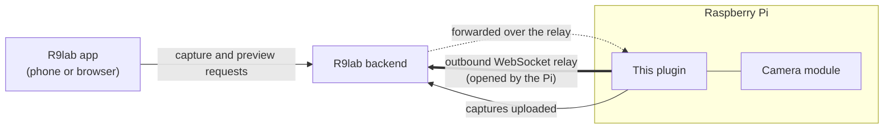

# RPI Camera Plugin

Device-side software for automated image capture on Raspberry Pi, integrated with the [R9lab platform](https://r9lab.io).

## Quick Links

- **[Installation Guide](INSTALL.md)** - hardware setup, pairing, Docker, standalone mode, and troubleshooting
- **[Architecture](ARCHITECTURE.md)** - runtime design, relay flow, auth boundaries, and configuration model
- **[Contributing](CONTRIBUTING.md)** - local development, tests, quality checks, and release workflow
- **[Platform Docs](https://docs.r9lab.io/user-guides/rpi-cam/)** - camera management in R9lab

## What It Does

The plugin runs a lightweight FastAPI server on a Raspberry Pi that:

- captures still images from the connected camera module
- publishes an HLS preview through the local MediaMTX sidecar
- connects to R9lab through an outbound WebSocket relay
- exposes local REST endpoints for setup, diagnostics, and direct integrations

Supported hardware is Raspberry Pi 5/4 with Camera Module 3/v2 on Raspberry Pi OS 64-bit.

## How It Connects

The Pi always opens the connection, so the relay needs no open port on the Pi's network. To pair, the Pi shows a short code on its `/setup` page, and you enter that code in the R9lab app. After that, the backend sends capture and preview requests down the relay, and the Pi only runs the routes it allows. The [platform docs](https://docs.r9lab.io/architecture/r9cam/) have the full diagram, with LAN direct mode, preview streaming and the pairing sequence. [ARCHITECTURE.md](ARCHITECTURE.md) covers the plugin's internals.

## Supported Modes

| Mode               | Purpose                                                        |
| ------------------ | -------------------------------------------------------------- |
| **Paired relay**   | The Pi opens an outbound WebSocket relay to the R9lab backend. |
| **Local direct**   | LAN/Ethernet clients call the Pi API with `X-API-Key`.         |
| **Backend upload** | Captures are pushed back to the R9lab backend.                 |
| **S3 upload**      | Captures are written to a configured S3-compatible bucket.     |

## Getting Started

1. Follow [INSTALL.md](INSTALL.md) to prepare the Pi, generate `compose.override.yml`, and start the service.
1. Set `PAIRING_BACKEND_URL` in `.env`.
1. Read the 6-character pairing code from `/setup` or the `PAIRING READY` log banner.
1. Enter the pairing code in the native R9lab app.
1. Visit `http://your-pi-ip:8018/setup` to check pairing, status, and diagnostics.

Use the generated [RPi camera API reference](https://docs.r9lab.io/api/rpi-cam/) for endpoint-level documentation. The Pi-hosted Swagger/OpenAPI routes are development-only.

The HTTPS-served R9lab web frontend cannot auto-probe the Pi's plain-HTTP local API because browsers block mixed content. Use the native app for pairing and direct-mode setup.

## Standalone Mode

The plugin can run without a R9lab backend by writing captures to an S3-compatible bucket. The default standalone stack uses a loopback-only RustFS sidecar and `APP_ENV=development` for local HTTP storage. Remote production S3 endpoints require HTTPS.

Captured images, queued retries, dead letters, and preview thumbnails are sensitive local device data. In standalone S3 mode, generated public URLs are reachable wherever the configured bucket, endpoint, or proxy is reachable, so keep image storage private or LAN-only when captures are sensitive.

See [INSTALL.md#standalone-mode](INSTALL.md#standalone-mode) for the complete `.env` example and runtime checks.

## Local Direct Mode

Local mode is enabled by default. On first boot the plugin generates a persistent local API key. Paired R9lab apps can retrieve that key through the relay for lower-latency LAN access, and custom local clients can use it with `X-API-Key`.

The local key is an auth gate for the direct interface. It does not register a camera in R9lab; relay pairing still does that. See [INSTALL.md#local-direct-mode](INSTALL.md#local-direct-mode) for key retrieval and network notes.

## Observability

The plugin writes redacted structured logs and can ship logs, metrics, and traces to an external observability stack. OTLP tracing is opt-in with `OTEL_ENABLED=true` and `OTEL_EXPORTER_OTLP_ENDPOINT`; remote production OTLP endpoints require HTTPS.

See [INSTALL.md#observability](INSTALL.md#observability) for operator configuration and [ARCHITECTURE.md#observability](ARCHITECTURE.md#observability) for the internal pipeline.

## Troubleshooting

Use [INSTALL.md#troubleshooting](INSTALL.md#troubleshooting) for operator issues. Use [CONTRIBUTING.md](CONTRIBUTING.md) for development setup and test workflow.

## Licensing

| What                                                   | Licence                            |
| ------------------------------------------------------ | ---------------------------------- |
| Plugin software                                        | [AGPL-3.0-or-later](LICENSE)       |
| The published API specification (`openapi.r9cam.json`) | [Apache-2.0](LICENSE-APACHE-2.0)   |
| The contract models package (`r9cam_models`, on PyPI)  | [Apache-2.0](r9cam_models/LICENSE) |

The specification and the contract models are carved out so that anyone writing a client, an
integration or their own device against this camera API does not inherit the plugin's copyleft.
This mirrors the same split in the [R9lab platform repository](https://github.com/CMLPlatform/r9lab),
so every published R9lab API schema answers the licensing question the same way.
